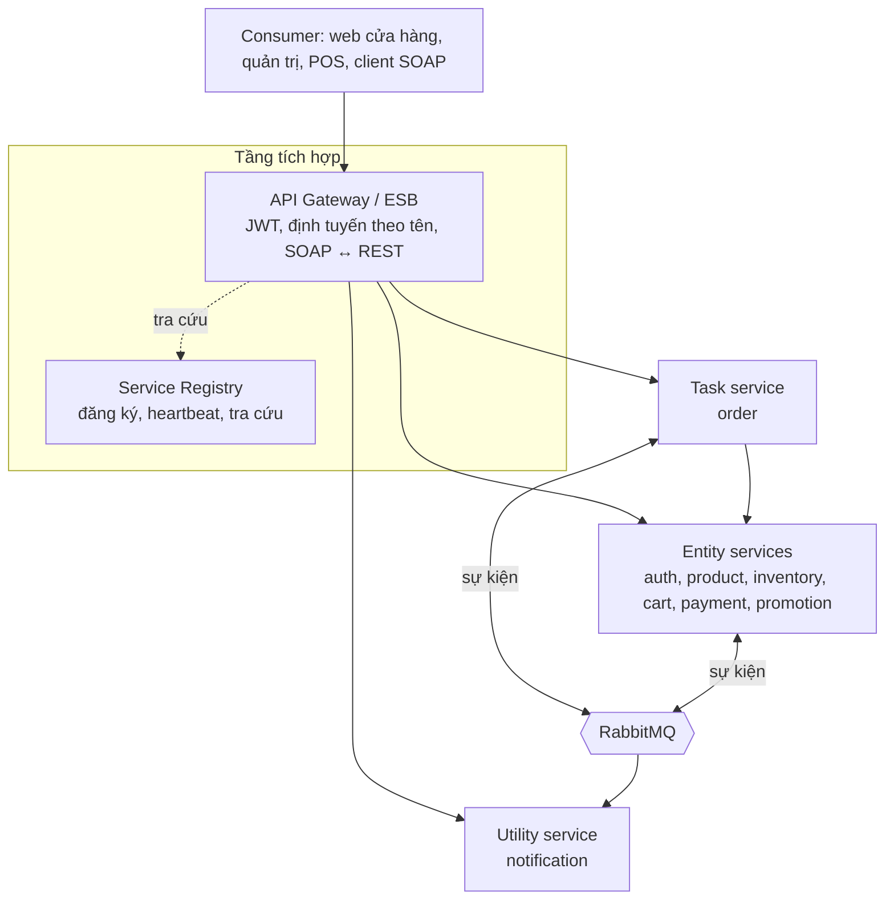

# Tạp Hóa Xanh — Hệ thống cửa hàng tạp hóa theo Kiến trúc hướng dịch vụ (SOA)

Ứng dụng bán hàng cho cửa hàng tạp hóa: khách đặt hàng online, nhân viên xử lý đơn, bán tại quầy (POS),
quản lý kho, nhập hàng, khuyến mãi và báo cáo doanh thu. Hệ thống gồm **8 dịch vụ nghiệp vụ** chia theo
lớp **task / entity / utility**, mỗi dịch vụ một CSDL riêng và một **hợp đồng OpenAPI**, được tìm thấy qua
**Service Registry**, giao tiếp qua **tầng tích hợp** (API Gateway đóng vai trò ESB nhẹ, có dàn xếp SOAP/WSDL ↔ REST)
và **RabbitMQ** (sự kiện bất đồng bộ).



Tài liệu: [Đối chiếu SOA](docs/soa.md) · [Kiến trúc chi tiết](docs/architecture.md) · [Danh sách API](docs/api.md) ·
Hợp đồng: [`contracts/`](contracts/)

## Kiến trúc hướng dịch vụ trong project

| Thành phần SOA | Hiện thực |
|---|---|
| Hợp đồng dịch vụ | OpenAPI 3.0 cho mọi service (`GET /contract`, `/api/contracts/<service>`), WSDL 1.1 cho CatalogService, file trong `contracts/` |
| Danh bạ & khám phá dịch vụ | `integration/registry`: service tự đăng ký + heartbeat, gateway và service tra cứu theo tên, xoay vòng nhiều instance |
| Phân lớp dịch vụ | `services/task` (điều phối quy trình), `services/entity` (thực thể nghiệp vụ), `services/utility` (hạ tầng dùng chung) |
| Tầng tích hợp / ESB | `integration/gateway`: định tuyến, xác thực, dàn xếp giao thức SOAP ↔ REST, biến đổi JSON ↔ XML |
| Kết hợp dịch vụ | Orchestration (Saga đặt hàng ở order-service) và choreography (sự kiện qua RabbitMQ) |
| Chất lượng dịch vụ | JWT, khóa nội bộ, rate limit, circuit breaker, retry, health check, truy vết X-Request-ID |
| Quản trị (governance) | Hợp đồng sinh từ code + kiểm tra khớp code, phiên bản `/api/v1`, 168 kiểm thử end-to-end |

Đối chiếu đầy đủ với 8 nguyên tắc SOA của Thomas Erl và SOA Reference Architecture: [docs/soa.md](docs/soa.md).

## Tính năng

**Khách hàng**
- Đăng ký / đăng nhập (JWT), hồ sơ, đổi mật khẩu, sổ địa chỉ giao hàng
- Duyệt theo danh mục, **tìm kiếm không dấu** ("gao st25" ra "Gạo ST25"), lọc giá, lọc hàng giảm giá, 7 kiểu sắp xếp
- Chi tiết sản phẩm, tồn kho, sản phẩm liên quan, đánh giá (chỉ khách đã mua & nhận hàng)
- Giỏ hàng luôn theo giá & tồn kho mới nhất; mã giảm giá; miễn phí giao hàng từ 300.000đ
- Thanh toán COD, chuyển khoản, ví điện tử Xanh Pay (mô phỏng); theo dõi đơn, tự hủy đơn
- Thông báo trong app + email (mô phỏng)

**Nhân viên / Quản trị viên** (`/admin/`)
- Dashboard doanh thu, đơn hàng (xác nhận → giao → hoàn tất, hủy tự hoàn kho / tiền / lượt mã)
- **Bán tại quầy (POS)**: quét mã vạch, tiền thối, in hóa đơn
- Sản phẩm, danh mục, kho (kiểm kê, ngưỡng cảnh báo, lịch sử), phiếu nhập, nhà cung cấp
- Mã giảm giá, thanh toán, người dùng & phân quyền, thông báo, nhật ký email
- **Trạng thái dịch vụ**: sức khỏe từng service, danh bạ Service Registry (instance, lớp, phiên bản, heartbeat)

**Cho nhà phát triển**
- `/api-docs.html`: xem hợp đồng của mọi service theo lớp, gửi thử SOAP request
- `/api/soap/catalog?wsdl`: WSDL của CatalogService

## Cấu trúc thư mục

```
├── services/                          # Các dịch vụ nghiệp vụ, chia theo lớp SOA
│   ├── task/
│   │   └── order-service/             # :8005  điều phối đặt hàng (Saga), POS, báo cáo
│   ├── entity/
│   │   ├── auth-service/              # :8001  người dùng, JWT, địa chỉ, phân quyền
│   │   ├── product-service/           # :8002  danh mục, sản phẩm, tìm kiếm, đánh giá
│   │   ├── inventory-service/         # :8003  tồn kho, giữ hàng, nhập kho, nhà cung cấp
│   │   ├── cart-service/              # :8004  giỏ hàng
│   │   ├── payment-service/           # :8006  thanh toán, hoàn tiền
│   │   └── promotion-service/         # :8007  mã giảm giá
│   └── utility/
│       └── notification-service/      # :8008  thông báo, email (chỉ nghe sự kiện)
├── integration/                       # Tầng tích hợp
│   ├── gateway/                       # :8000  API Gateway / ESB (app.py, soap.py)
│   └── registry/                      # :8500  Service Registry
├── contracts/                         # Hợp đồng dịch vụ: openapi/*.json, wsdl/catalog.wsdl
├── common/                            # Thư viện hạ tầng dùng chung: DB, event bus, registry client,
│                                      #   hợp đồng OpenAPI, auth/JWT, HTTP client + circuit breaker
├── frontend/                          # Lớp consumer: cửa hàng, admin/, api-docs.html
├── infra/                             # Script tạo database PostgreSQL, cấu hình nginx
├── scripts/export_contracts.py        # Xuất / kiểm tra hợp đồng dịch vụ
├── tests/e2e_test.py                  # 168 kiểm thử end-to-end qua gateway
├── docs/                              # soa.md, architecture.md, api.md, slide báo cáo
├── docker-compose.yml
└── run_local.py                       # Chạy toàn bộ hệ thống không cần Docker
```

Mỗi service: `app.py`, `Dockerfile`, `requirements.txt`.

## Cách chạy

### Cách 1 — Docker Compose (PostgreSQL + RabbitMQ + Registry)

Yêu cầu: Docker Desktop.

```bash
docker compose up -d --build
docker compose up -d --scale product-service=2     # tùy chọn: chạy 2 instance, gateway tự cân bằng tải
```

| Địa chỉ | Nội dung |
|---|---|
| http://localhost:8080 | Cửa hàng |
| http://localhost:8080/admin/ | Trang quản trị (mục "Trạng thái dịch vụ" có danh bạ registry) |
| http://localhost:8080/api-docs.html | Hợp đồng dịch vụ OpenAPI + WSDL |
| http://localhost:8000/api/health | Sức khỏe các service (gọi thẳng gateway) |
| http://localhost:15672 | RabbitMQ Management (`grocery` / `grocery`) |
| `localhost:5433` | PostgreSQL (`grocery` / `grocery`), 8 database `*_db` |

Dừng: `docker compose down` · Xóa sạch dữ liệu: `docker compose down -v` · Log: `docker compose logs -f order-service`

### Cách 2 — Chạy local không cần Docker

Yêu cầu: Python 3.10 trở lên.

```bash
pip install -r requirements-local.txt
python run_local.py                    # thêm --reset để xóa dữ liệu cũ
python run_local.py --scale product=2  # chạy 2 instance product-service
```

Mở http://localhost:8000 (cửa hàng), http://localhost:8000/admin/ (quản trị), http://localhost:8000/api-docs.html (hợp đồng).
Chế độ này dùng SQLite riêng cho từng service (thư mục `data/`) và event bus qua HTTP thay cho RabbitMQ
(mỗi service nhận sự kiện ở một instance, giống competing consumers); registry, hợp đồng và SOAP hoạt động như bản Docker.

## Tài khoản & dữ liệu mẫu

| Vai trò | Email | Mật khẩu |
|---|---|---|
| Quản trị viên | admin@taphoa.vn | Admin@123 |
| Nhân viên | staff@taphoa.vn | Staff@123 |
| Khách hàng | khach@taphoa.vn | Khach@123 |

10 danh mục, 55 sản phẩm (có mã vạch, vài sản phẩm sắp hết / hết hàng), 3 nhà cung cấp, mã giảm giá
`WELCOME10`, `GIAM20K`, `SALE50K`, `VIP15` (mã riêng). Mã vạch thử POS: `8930000000295` (Coca-Cola lon).

## Kiểm thử

```bash
pip install requests lxml                                  # lxml để kiểm tra SOAP theo XSD (không bắt buộc)
python tests/e2e_test.py                                   # local: http://localhost:8000
GATEWAY_URL=http://localhost:8080 python tests/e2e_test.py # Docker, qua nginx
# Windows PowerShell: $env:GATEWAY_URL="http://localhost:8080"; python tests/e2e_test.py
python scripts/export_contracts.py --check                 # hợp đồng trong contracts/ có khớp code không
```

168 kiểm thử: bảo mật & phân quyền, tìm kiếm, giỏ hàng, mã giảm giá, Saga đặt hàng và bù trừ, vòng đời đơn,
thanh toán ví tự xác nhận đơn qua sự kiện, hủy & hoàn tiền, POS, kho, báo cáo, thông báo, rate limiting,
**Service Registry** (đăng ký, phân lớp, cân bằng tải), **hợp đồng OpenAPI** (đủ mô tả, không lộ API nội bộ,
khớp file `contracts/`) và **SOAP/WSDL** (3 thao tác, SOAP Fault, chặn DTD, hợp lệ theo XSD).

## Kịch bản demo gợi ý

1. `/admin/#system`: 8 service + registry đều UP, xem danh bạ instance và lớp dịch vụ.
2. `/api-docs.html`: mở hợp đồng order-service (task) và inventory-service (entity); tab api-gateway gửi thử SOAP.
3. Khách tìm "nuoc mam", thêm giỏ, áp `WELCOME10`, đặt hàng COD; RabbitMQ Management thấy message `order.created`.
4. Đặt đơn bằng Xanh Pay → thanh toán → đơn tự "Đã xác nhận" (sự kiện `payment.completed`, choreography).
5. Đặt sản phẩm hết hàng qua API → 409, không có đơn rác (Saga bù trừ, orchestration).
6. Nhân viên xử lý đơn; POS quét `8930000000295`, in hóa đơn.
7. `docker compose up -d --scale product-service=2` → registry thấy 2 instance, header `X-Instance` luân phiên.
8. `docker compose stop registry` → hệ thống vẫn bán hàng (địa chỉ dự phòng); `start registry` → service tự đăng ký lại.
9. `docker compose stop inventory-service` → cửa hàng vẫn xem được sản phẩm, đặt hàng báo lỗi rõ ràng.

## Xử lý sự cố

- **Cổng đã bị dùng** (8000, 8080, 5433, 5672, 15672): tắt ứng dụng chiếm cổng hoặc đổi cổng trong `docker-compose.yml`.
- **Service khởi động lại vài lần lúc đầu**: PostgreSQL / RabbitMQ / registry chưa sẵn sàng, service tự kết nối lại sau 30–60 giây.
- **Dữ liệu mẫu ban đầu**: `docker compose down -v` hoặc `python run_local.py --reset`.
- **Triển khai thật**: sao chép `.env.example` thành `.env`, đặt `JWT_SECRET`, `INTERNAL_API_KEY`, mật khẩu DB / RabbitMQ.
