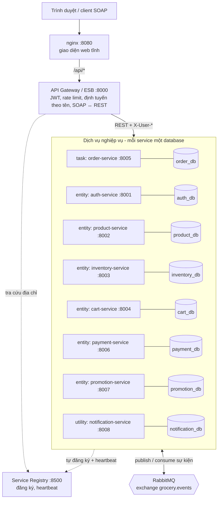
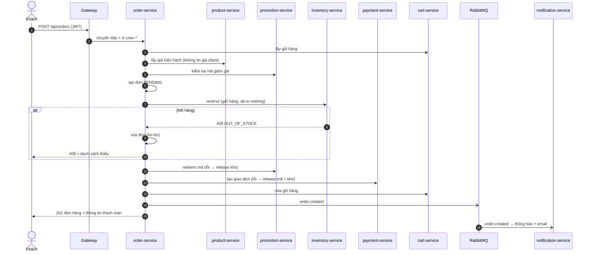

# Kiến trúc hệ thống Tạp Hóa Xanh

## 1. Tổng quan

Hệ thống bán hàng cho một cửa hàng tạp hóa, gồm kênh **online** (khách đặt hàng trên web) và **bán tại quầy (POS)**,
xây theo kiến trúc hướng dịch vụ: 8 dịch vụ nghiệp vụ chia theo lớp task / entity / utility, tầng tích hợp
(API Gateway đóng vai trò ESB nhẹ + Service Registry) và lớp consumer (giao diện web, client SOAP).
Đối chiếu chi tiết với nguyên tắc SOA: [soa.md](soa.md).

Giao tiếp **đồng bộ** (REST nội bộ, có `X-Internal-Token`; địa chỉ đích tra cứu qua Service Registry theo tên):

| Service gọi | Gọi tới | Mục đích |
|---|---|---|
| order | product | Lấy giá hiện hành khi đặt hàng |
| order | inventory | Giữ hàng / xuất kho / trả hàng (Saga) |
| order | promotion | Kiểm tra, ghi nhận, hoàn lượt mã giảm giá |
| order | payment | Tạo giao dịch, thu COD, hủy / hoàn tiền |
| order | cart, auth | Lấy giỏ hàng, xóa giỏ; lấy địa chỉ giao hàng |
| cart | product, inventory | Giá và tồn kho mới nhất cho giỏ |
| product | inventory | Hiển thị số lượng còn lại |
| product | order | Kiểm tra khách đã mua trước khi cho đánh giá |
| inventory | product | Bổ sung bản sao sản phẩm nếu sự kiện đến chậm |
| gateway | order, inventory, product, auth | Dashboard (API Composition) |

| Thành phần | Trách nhiệm | Dữ liệu sở hữu |
|---|---|---|
| **api-gateway** (tích hợp) | Điểm vào duy nhất; xác thực JWT; định tuyến theo tên qua registry; dàn xếp SOAP ↔ REST; công bố hợp đồng; rate limit; health tổng hợp; dashboard (API Composition) | — |
| **registry** (tích hợp) | Danh bạ dịch vụ: đăng ký, heartbeat, tra cứu instance theo tên | bộ nhớ (tự đăng ký lại khi khởi động lại) |
| **auth-service** | Đăng ký, đăng nhập, phát JWT, hồ sơ, sổ địa chỉ, phân quyền admin / staff / customer | `users`, `addresses` |
| **product-service** | Danh mục, sản phẩm, giá & giá khuyến mãi, tìm kiếm không dấu, đánh giá | `categories`, `products`, `reviews` |
| **inventory-service** | Tồn kho, giữ hàng cho đơn, xuất/nhập kho, kiểm kê, nhà cung cấp, cảnh báo sắp hết | `stocks`, `stock_movements`, `reservations`, `suppliers`, `stock_receipts` |
| **cart-service** | Giỏ hàng của khách | `cart_items` |
| **order-service** | Đặt hàng (điều phối Saga), POS, vòng đời đơn, báo cáo doanh thu | `orders`, `order_items`, `order_status_history` |
| **payment-service** | Giao dịch COD / chuyển khoản / ví điện tử (mô phỏng) / tiền mặt; hoàn tiền | `payments`, `payment_logs` |
| **promotion-service** | Mã giảm giá: điều kiện, giới hạn lượt, ghi nhận & hoàn lượt | `coupons`, `coupon_usages` |
| **notification-service** | Thông báo trong app và email (mô phỏng), chỉ lắng nghe sự kiện | `notifications`, `notification_reads`, `email_logs` |

## 2. Các mẫu kiến trúc (patterns) được áp dụng

| Mẫu | Ở đâu trong code |
|---|---|
| **API Gateway** | `integration/gateway/app.py` — một cổng vào, ẩn địa chỉ nội bộ, không định tuyến `/internal/*` |
| **Service Registry + Client-side Discovery** | `integration/registry/app.py`, `common/registry.py` — tự đăng ký, heartbeat, tra cứu theo tên, round-robin, dự phòng cấu hình tĩnh |
| **Service Contract (OpenAPI / WSDL)** | `common/contract.py` sinh OpenAPI từ code; `GET /contract`; `contracts/`; `scripts/export_contracts.py --check` |
| **ESB: Protocol Mediation + Message Transformation** | `integration/gateway/soap.py` — CatalogService SOAP 1.1 ↔ REST product-service, JSON ↔ XML, SOAP Fault |
| **Service Layers (task / entity / utility)** | Thư mục `services/task`, `services/entity`, `services/utility`; `layer` trong health, hợp đồng, registry |
| **Database per Service** | Mỗi service một database (`infra/postgres/init-databases.sql`), không service nào đọc DB của service khác |
| **Gateway Offloading (xác thực tập trung)** | Gateway giải mã JWT, chuyển `X-User-Id/Role/Name/Email` + `X-Internal-Token` xuống service (`common/auth.py`) |
| **Saga (Orchestration)** | `order-service`: `run_saga()` giữ hàng → ghi nhận mã → tạo thanh toán; lỗi thì `compensate()` theo thứ tự ngược |
| **Event-driven / Publish–Subscribe** | `common/events.py` + RabbitMQ topic exchange `grocery.events` |
| **Idempotent Consumer** | Bảng `processed_events` lưu id sự kiện đã xử lý; các API nội bộ reserve / redeem / create payment idempotent theo `order_id` |
| **Dead Letter Queue** | Message xử lý lỗi 2 lần chuyển vào `grocery.dead-letters` |
| **Data replication qua sự kiện** | inventory-service lưu bản sao tên/SKU sản phẩm từ `product.created/updated` |
| **API Composition** | `GET /api/dashboard` gộp dữ liệu 4 service song song, trả kết quả một phần nếu có service lỗi |
| **Circuit Breaker + Timeout + Retry** | `common/http_client.py` — mở mạch sau 5 lỗi liên tiếp; instance không kết nối được thì thử instance khác |
| **Graceful degradation** | Kho lỗi → danh sách sản phẩm vẫn hiển thị (ẩn tồn kho); notification lỗi → đặt hàng vẫn chạy |
| **Rate limiting** | Token bucket theo IP ở gateway, chặt hơn cho `/api/auth/login` |
| **Health Check** | `GET /health` mỗi service (kèm kiểm tra DB) + Docker `HEALTHCHECK` + `/api/health` tổng hợp |
| **Correlation ID** | `X-Request-ID` được truyền qua mọi lời gọi service-to-service và ghi vào log |
| **Externalized configuration** | Toàn bộ cấu hình qua biến môi trường (`common/config.py`, `docker-compose.yml`) |

## 3. Luồng đặt hàng online (Saga)

Thanh toán ví điện tử là bất đồng bộ: `payment-service` phát `payment.completed`, `order-service` nghe sự kiện,
đánh dấu đã thanh toán và **tự động xác nhận đơn**.

**Vòng đời đơn online:** `PENDING → CONFIRMED → SHIPPING → DELIVERED`, hủy được ở `PENDING`/`CONFIRMED`.

| Chuyển trạng thái | Tác động sang service khác |
|---|---|
| → `SHIPPING` | inventory `commit`: trừ tồn thực tế, ghi phiếu xuất |
| → `DELIVERED` | COD: payment `mark-paid`; phát `order.completed` → product tăng "đã bán" |
| → `CANCELLED` | inventory `release`, payment `cancel` (hoặc hoàn tiền nếu đã trả), promotion `release` |

**Bán tại quầy (POS):** reserve → redeem → thanh toán ngay → commit kho → đơn `COMPLETED` trong một request.

## 4. Danh mục sự kiện

| Sự kiện | Phát bởi | Lắng nghe bởi | Tác dụng |
|---|---|---|---|
| `user.registered` | auth | notification | Thông báo chào mừng + email kèm mã WELCOME10 |
| `product.created` / `product.updated` | product | inventory | Tạo / cập nhật bản sao sản phẩm trong kho, tồn đầu kỳ |
| `order.created` | order | notification | Thông báo khách + email xác nhận + báo nhân viên có đơn mới |
| `order.status_changed` | order | notification | Thông báo khách khi đơn đổi trạng thái |
| `order.cancelled` | order | notification | Thông báo khách + nhân viên |
| `order.completed` | order | product | Cộng số lượng đã bán (sắp xếp "bán chạy") |
| `payment.completed` | payment | order, notification | Đánh dấu đã thanh toán, tự xác nhận đơn online |
| `payment.failed` | payment | notification | Báo khách thanh toán chưa thành công |
| `payment.refunded` | payment | order, notification | Cập nhật trạng thái hoàn tiền |
| `inventory.low_stock` | inventory | notification | Cảnh báo nhân viên nhập hàng (chỉ báo 1 lần cho tới khi nhập lại) |
| `inventory.restocked` | inventory | — | Dành cho mở rộng (ví dụ báo khách đang chờ hàng) |

Cấu trúc message: `{"id", "type", "source", "occurred_at", "data": {...}}`. Mỗi service có một queue bền vững
`<service>.events` gắn vào exchange với các routing key mà nó quan tâm.

## 5. Bảo mật

- Mật khẩu băm bằng `werkzeug.security` (scrypt). JWT HS256, hết hạn sau 24 giờ.
- Phân quyền theo vai trò ở từng service (`require_auth`, `require_staff`, `require_admin`).
- Service **chỉ tin** header danh tính khi có `X-Internal-Token` hợp lệ → gọi thẳng service bỏ qua gateway không giả mạo được người dùng.
- Gateway xóa mọi header `X-User-*` / `X-Internal-Token` do client gửi lên.
- Trong Docker, chỉ nginx (8080) và gateway (8000) mở cổng ra ngoài; các service chỉ nằm trong mạng nội bộ.
- Giá luôn lấy từ product-service khi đặt hàng, không tin giá do client gửi.
- Chống bán âm kho: giữ hàng bằng câu lệnh `UPDATE ... WHERE quantity - reserved >= ?` (nguyên tử), đã kiểm thử 15 đơn đồng thời tranh 6 sản phẩm.

## 6. Chạy & mở rộng

- **Docker Compose**: PostgreSQL 16 (8 database), RabbitMQ 3.13, Service Registry, 8 service + gateway (gunicorn), nginx.
- **Local**: `run_local.py` chạy registry, 8 service và gateway, SQLite riêng cho từng service, event bus qua HTTP (gửi tới một instance mỗi service theo registry).
- Mỗi service stateless nên scale ngang được: `docker compose up -d --scale product-service=3`. Instance mới tự đăng ký
  vào registry, gateway và các service tự chia tải; với RabbitMQ các instance cùng service dùng chung một queue
  (competing consumers) nên mỗi sự kiện chỉ xử lý một lần. Khởi tạo bảng và dữ liệu mẫu dùng advisory lock của
  PostgreSQL nên nhiều instance khởi động cùng lúc không bị trùng. Bộ đếm rate-limit nằm trong bộ nhớ gateway,
  nếu chạy nhiều gateway nên chuyển sang Redis.
- Hướng mở rộng: Outbox pattern để đảm bảo phát sự kiện tuyệt đối, Redis cache cho danh sách sản phẩm,
  service discovery (Consul) / Kubernetes, tracing (OpenTelemetry + Jaeger), cổng thanh toán thật (VNPay, MoMo).
